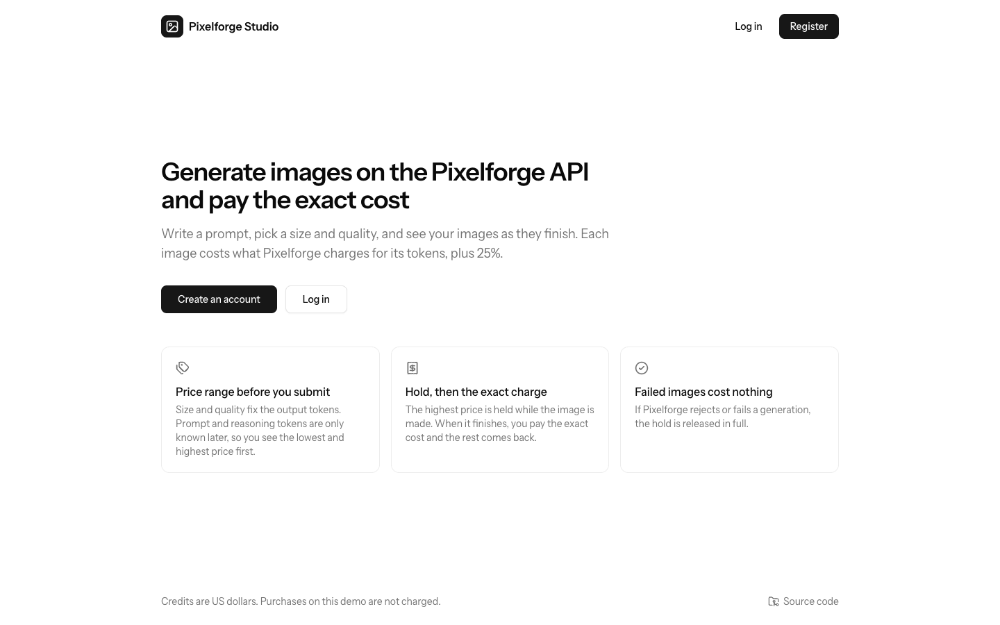
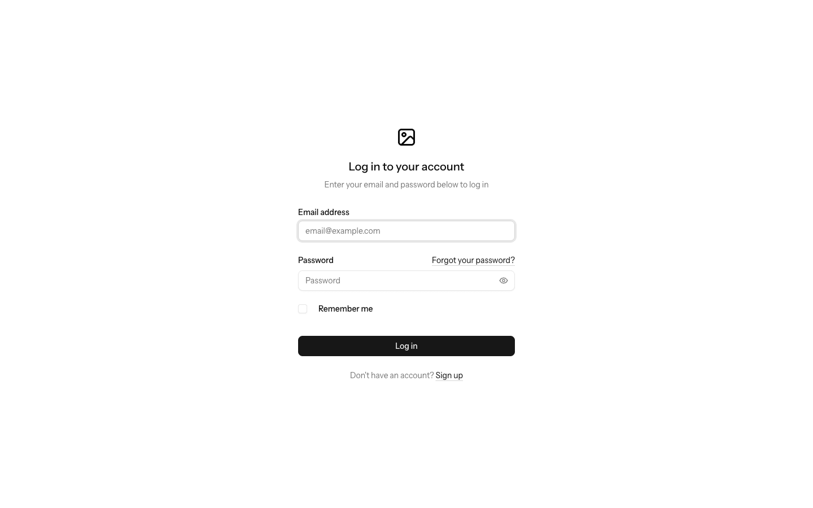
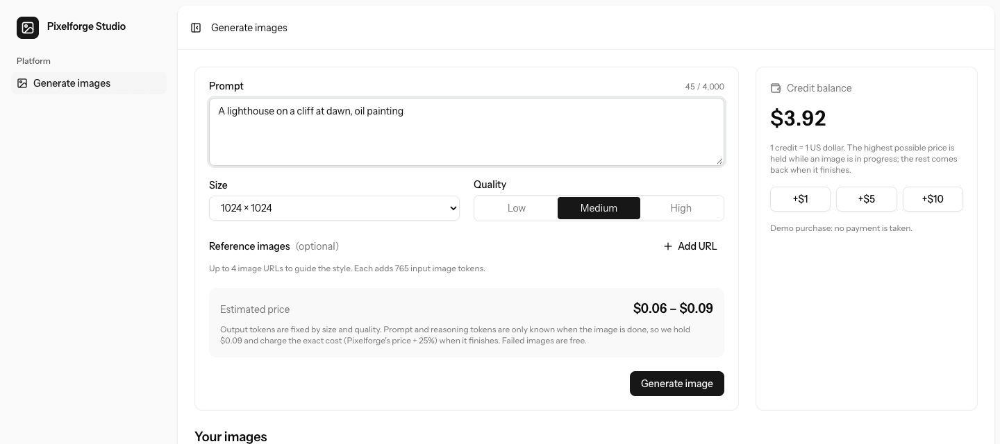
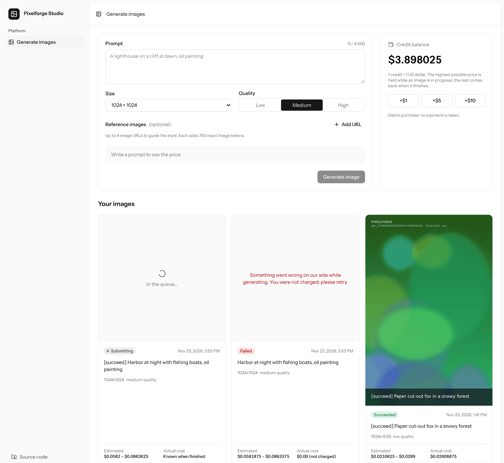
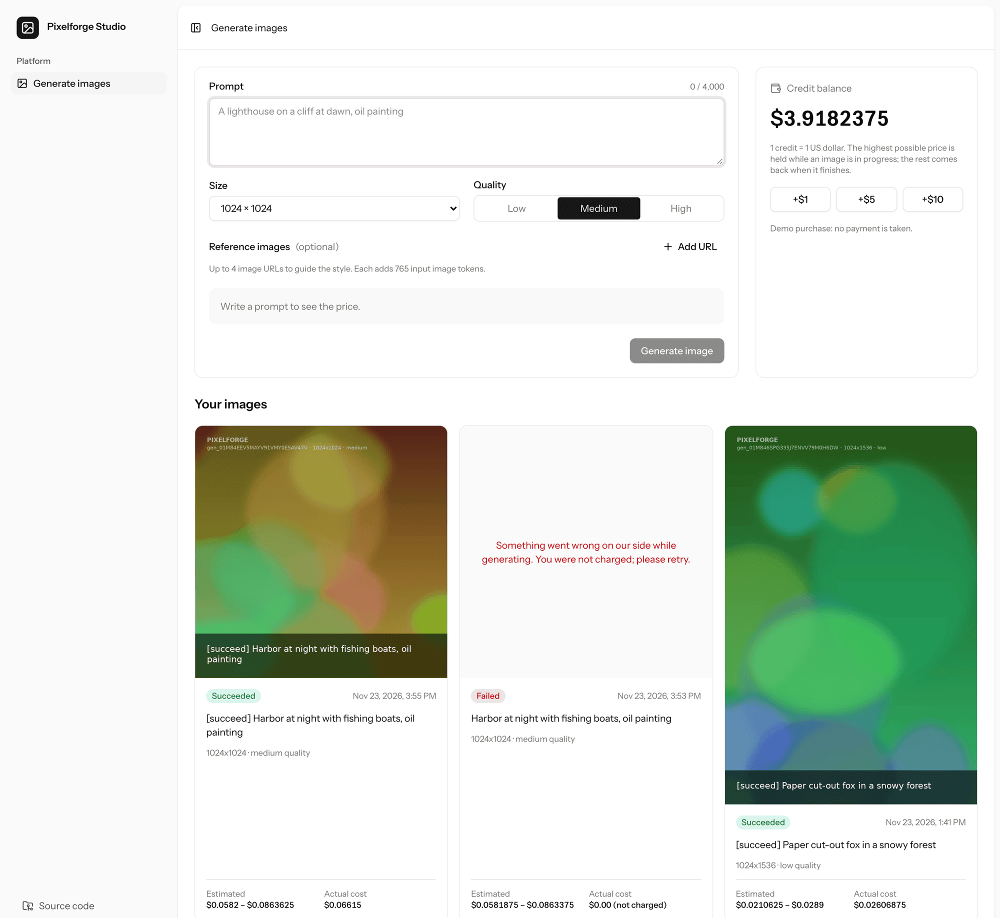
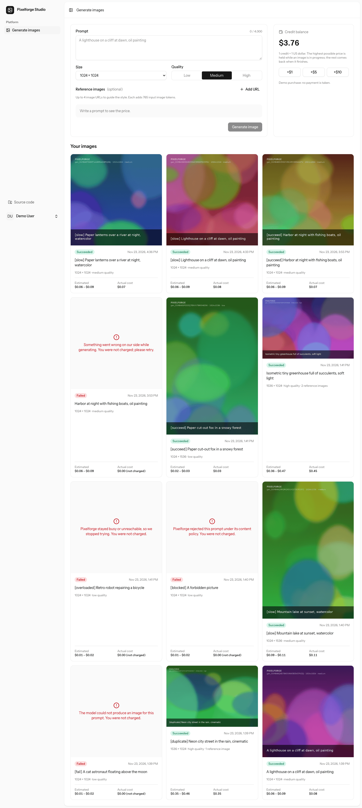
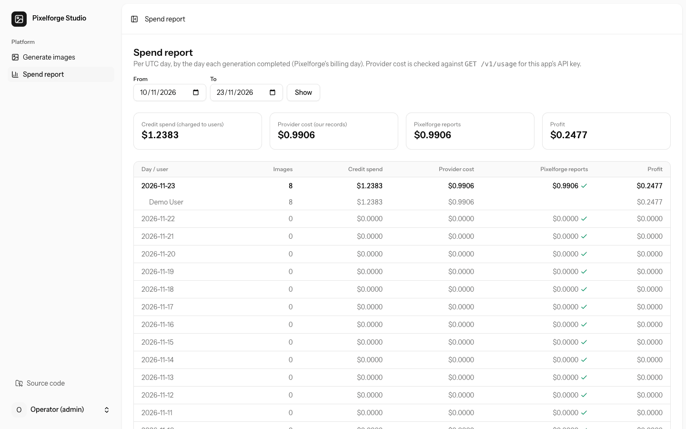
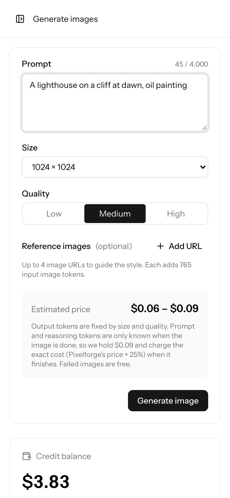

# Pixelforge Studio

Image generation on the Pixelforge API, with exact per-token billing. Laravel 13, Vue 3, Inertia 3, Tailwind.

Live: https://pixelforge-studio.162-0-214-46.sslip.io

## Screenshots

Taken from the live app. The user screens use the demo account; the spend report uses the admin account.

**Welcome page**: what the app does, with log in and register.



**Log in**



**Generate**: the price range ($0.06 – $0.09) shows before you submit. The top of the range is what the app holds.



**Hold at submit**: the balance drops by the highest price, $3.834209375 − $0.08635625 = $3.747853125 (shown as $3.75).



**Exact charge when done**: the hold is released and the exact cost, $0.072478125 (shown as $0.07), is charged: $3.747853125 + $0.08635625 − $0.072478125 = $3.76173125 (shown as $3.76).



**History**: status, estimated range, actual cost and the failure reason for each image. Failed images cost $0.00.



**Spend report** (`/admin/report`, admins only): credit spend, provider cost and profit per UTC day and per user, to 4 decimals. A check mark shows that the day's provider cost matches `GET /v1/usage`.



**Mobile**: the generate form on a 390 px wide phone screen.



## What it does

- **Generate**: prompt, size, quality and up to 4 reference image URLs. The price range is shown before you submit (from `GET /v1/pricing`).
- **Billing**: Pixelforge's cost + 25%. At submit the app holds the highest possible price; when the generation finishes it releases the hold and charges the exact cost. Failed generations cost nothing.
- **History**: live status (submitting, queued, processing, succeeded, failed), estimated range, actual cost, image, and the reason for a failure or a retry.
- **Balances** (stretch): a credit balance, "Buy credits" buttons (fake purchase), and a block when the balance is below the highest possible price.
- **Spend report** (stretch, `/admin/report`, admins only): credit spend, provider cost and profit per UTC day and per user, with each day's provider cost checked against `GET /v1/usage`.

## Money

- Every amount is an integer number of **nanodollars** (1 USD = 10^9). Pixelforge reports costs with 9 decimal places, so integers hold every cost exactly. No floats anywhere. See `app/Billing`.
- Provider cost = Σ tokens × rate, using the `rates` on the generation object (fixed when it was created), not today's rates. If a rate ever needed a fraction of a nanodollar, `Rates::costOf()` throws rather than round.
- User price = cost × 1.25, rounded **up** to the next nanodollar. The rounding is at most $0.000000001 per generation, and always in the operator's favour, so we never sell below cost + markup.
- The estimate range uses the published token rules: text tokens = ceil(characters / 4) ± 15% (Unicode characters, not bytes), 765 tokens per reference image, exact output tokens, and the min/max reasoning tokens for the quality. The top of the range is what we hold.
- **Exact in storage, rounded on screen.** One formatter (`resources/js/lib/money.ts`) shows every amount: balances and charges to the cent ($3.76), a non-zero amount below a cent as "< $0.01", price ranges to the cent ($0.06 – $0.09, or 4 decimals when both ends round to the same cent), and the admin report to 4 decimals. Hover over an amount to see its exact value to the nanodollar. Rounding is only for display; holds, charges and balances always use the exact value.
- Every balance change is a row in `credit_transactions` (`purchase`, `hold`, `hold_release`, `charge`), and `users.balance_nanodollars` moves by the same amount in the same transaction. A unique index on `(generation_id, type)` makes a second charge for the same generation impossible at the database level.

## Pixelforge's failure modes

| What Pixelforge does                         | What the app does                                                                                                                                                                                                                                                                    |
| -------------------------------------------- | ------------------------------------------------------------------------------------------------------------------------------------------------------------------------------------------------------------------------------------------------------------------------------------ |
| 429 rate / concurrency limit, 503 overloaded | `SubmitGeneration` job waits for `Retry-After` (backoff, cap 60 s, jitter) and tries again with the same `Idempotency-Key` (the generation's UUID). The card shows "Waiting for Pixelforge". After 25 attempts it gives up, marks the generation failed and refunds the hold.        |
| 400 content policy, 422, daily limit         | Failed at once, nothing charged, the reason is shown.                                                                                                                                                                                                                                |
| Network error or timeout on create           | Retried with the same `Idempotency-Key`, so Pixelforge never creates a second generation.                                                                                                                                                                                            |
| Generation fails after it was accepted       | `generation.failed` → failed, hold released, $0.                                                                                                                                                                                                                                     |
| Webhook delivered twice                      | The event id is stored in `webhook_events` (unique) in the same transaction that applies the event. A repeat is skipped.                                                                                                                                                             |
| Webhooks out of order                        | `GenerationUpdater` locks the row and only moves a generation forward (pending → queued → processing → succeeded/failed). Final generations never change, so a late `processing` event is ignored and a generation is charged once even if a webhook and a poll both report success. |
| Webhook before the create request returns    | The generation's UUID is sent in `metadata`, so the webhook finds the row and links the provider id.                                                                                                                                                                                 |
| Webhook never arrives                        | `generations:sync` (every minute) polls queued/processing generations that have been quiet for 90 s and applies the result through the same updater.                                                                                                                                 |
| Bad or replayed signature                    | HMAC-SHA256 of `t.body`, compared in constant time, 5-minute tolerance. Rejected with 400 before anything is stored.                                                                                                                                                                 |

Image URLs expire after 24 hours; the card then says so.

## Code map

- `app/Billing` – money, rates, markup, estimator, ledger, spend report
- `app/Pixelforge` – HTTP client, error type, webhook signature
- `app/Generations/GenerationUpdater.php` – the only place a generation changes state or is charged
- `app/Generations/WebhookEventHandler.php` – event dedupe + apply
- `app/Jobs/SubmitGeneration.php` – submit with retries
- `app/Console/Commands/SyncActiveGenerations.php` – polling fallback
- `resources/js/pages/generations/Index.vue`, `resources/js/pages/admin/SpendReport.vue`

## Run it locally

```bash
composer install && npm install
cp .env.example .env && php artisan key:generate
# set PIXELFORGE_API_KEY and PIXELFORGE_WEBHOOK_SECRET (one key per environment)
php artisan migrate
npm run build
composer run dev   # app, queue worker, Vite
php artisan schedule:work   # polling fallback
```

Make a user an admin: `php artisan tinker --execute="App\Models\User::where('email', 'you@example.com')->update(['is_admin' => true]);"`

Webhooks need a public URL (Expose, ngrok or Cloudflare Tunnel) pointed at `/webhooks/pixelforge`.

## Tests

```bash
php artisan test
```

The tests never call Pixelforge (`Http::preventStrayRequests()`). They cover the documented cost examples, the worst-case estimate, markup rounding, holds and blocking, retries on limits, free failures, signature checks, duplicate and out-of-order webhooks, a webhook before the create response, polling, credits and the spend report against `/v1/usage`.

## Choices and trade-offs

- **Hold the maximum, then settle.** Users never see a charge above the range shown, and two quick submits cannot spend the same credits (the balance check and the debit are one conditional `UPDATE`).
- **Submit in a queued job**, not in the request: limits and overloads are normal, and the page stays fast. The trade-off is a "Submitting" state for a second or two.
- **One state machine** for webhooks, the create response and polling, so every path follows the same forward-only rules.
- **If we give up retrying** after network errors, there is a small chance Pixelforge did accept the request. The updater logs an error if Pixelforge later reports success for a generation we marked failed; the spend report would also show the difference against `/v1/usage`.
- Images are not copied to our storage, as the brief allows.

## Deployment

A 2 GB VPS: nginx + PHP-FPM 8.4 + MariaDB, two `queue:work` processes under Supervisor, `schedule:run` from cron, Let's Encrypt TLS. The host name uses sslip.io so it resolves to the server's IP without a DNS change.
